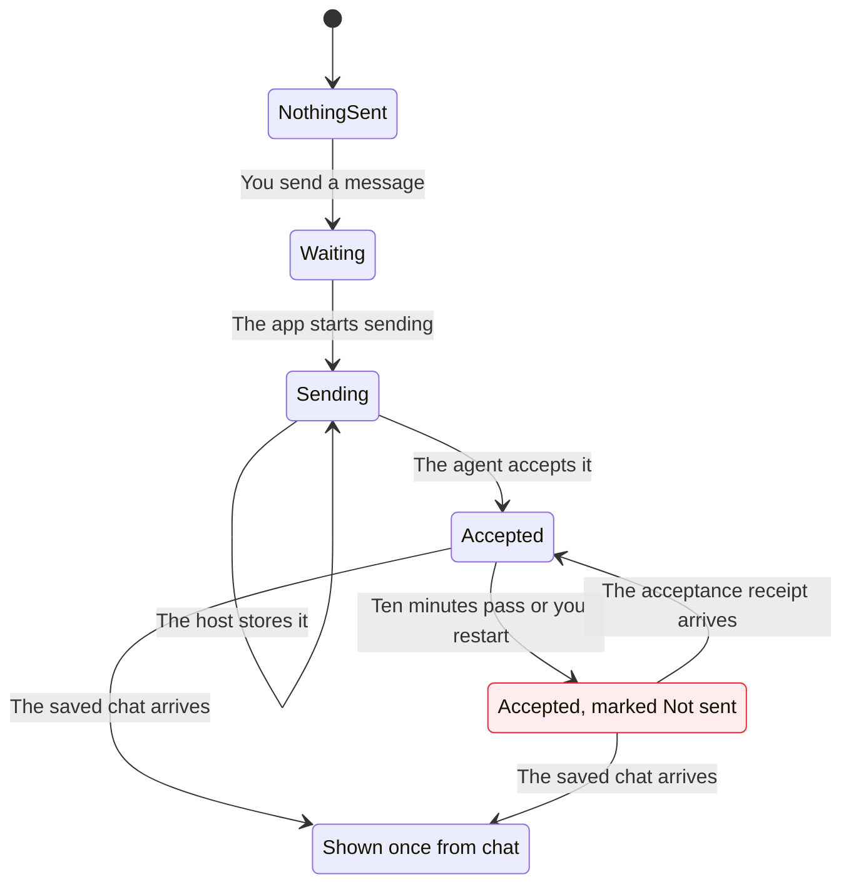

# Chat delivery counterexamples

The goal is one visible copy per sent message, with no false **Not sent** copy. The unchanged source at `9dd167dad7dde81749519038b0bcc5866c6deebb` violates the second promise in two event orders.

## Timeout without the acceptance receipt

`NoFalseNotSent` means an agent-accepted message must not be labeled **Not sent**. The all-events /statechart report finds this shortest path:

0. Nothing sent.
1. You send a message.
2. The app starts sending.
3. The host stores it.
4. The agent accepts it.
5. Ten minutes pass without the acceptance receipt or transcript reaching the app. The app labels it **Not sent**.

`chatOutboxTick` changes an unconfirmed v1 entry to `.not_sent` based on elapsed time. Neither that branch nor `showsNotSent` checks whether the agent actually accepted the message. A lost connection can hide the acceptance receipt. This is a decision-level counterexample, not a captured Windows screen.

## Restart before the acceptance receipt

The resume-only /statechart report checks the same invariant with the timeout action disabled:

0. Nothing sent.
1. You send a message.
2. The app starts sending.
3. The host stores it.
4. The agent accepts it.
5. You restart the app before its receipt arrives. The written `.sending` entry loads as `.not_sent` and the app labels it **Not sent**.

`chatOutboxParseJson` calls `stateOnLoad` with the saved state and write reservation. `stateOnLoad(1, true)` returns `.not_sent`; `showsNotSent(true, .not_sent, "sent", ...)` then returns true. Reconnection can correct the state later, but the earlier false failure already breaks the promise.

These are separate source decisions and need separate product tickets. Do not change the invariant or product code in this verification PR.

## Source replay and controls

The check retains native Zig source, compiler output, per-action state assertions and real temporary SQLite store replay in its output directory. The terminal-send and transcript boundaries use the existing synthetic host fixture. No provider, SSH connection or actual desktop window is involved.

The native decisions are compiled from the checkout, not hand-reimplemented. Every replay must reproduce the modeled local state, visible copy count and failure-label predicate. The host replay must store repeated submissions idempotently and reach real connector acceptance before a false-failure claim is confirmed.

`--self-test` plants a missing reconciliation decision in real source and requires two visible copies. It also plants a delivered-message failure label in real source and requires an accepted-message false failure in the reliable control. Both must replay. Restoring the original source must return to its original results.

The current all-events model has 234 reachable states. The resume-only model has 84. `SingleVisibleCopy` holds in the stated exact-text, single-message scope. It does not prove assistant reply reconciliation, all message strings or real Windows painting. The chart hides disconnect/reconnect and other steps that do not change its visible labels.

## Statechart

This abbreviated chart shows the two shortest counterexamples. Use pstack /statechart on each generated config for the complete chart and numbered report. Do not infer a pass from the chart alone. The raw TLC result and successful source replay are required.
