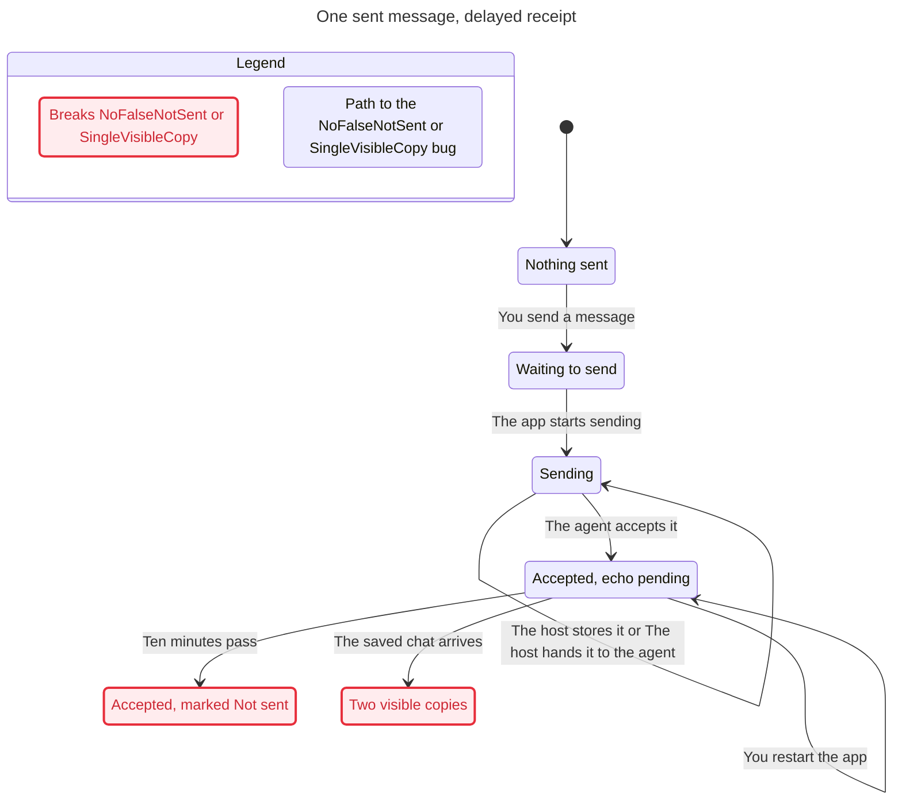
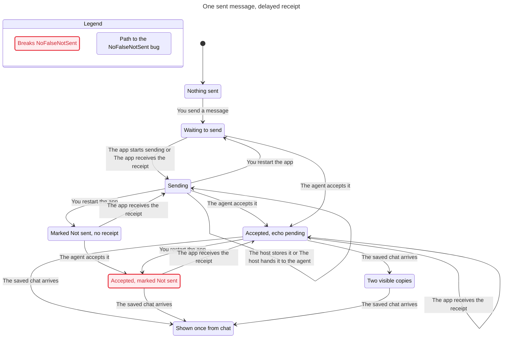

# Chat delivery counterexamples

The goal is one visible copy per sent message, with no false **Not sent** copy. The following counterexamples are historical. The source at `9dd167dad7dde81749519038b0bcc5866c6deebb` violates both promises in the bounded model.

## Source fixes

At `6baea66c637034b9d6285a5894de3ed7ffb24fe5`, the source decisions change as follows:

- SOFT-2724 removes age-only v1 failure transitions and failure labels. Explicit failed receipts still show **Not sent**; an acceptance receipt clears a stale failure label.
- SOFT-2725 restores queued/sending v1 entries as uncertain queued entries. Their write reservation prevents a duplicate send. Legacy restoration and explicit failure states remain unchanged.
- SOFT-2726 includes restored v1 entries in transcript reconciliation even after empty-phase recovery cleared their write flags. The assignment still permits only one pending entry to claim a user block.

The [hosted native probe](https://github.com/valentinyeo/multiprompt/actions/runs/44392581466) executed these source decisions. Its observed table passes all three unchanged properties in bounded TLC. The model, event bounds and invariants are unchanged. Full native/store replay, both planted breaks and restoration are required before a source pass is reported. Historical paths below remain regression evidence, not inherited findings to accept on the repaired source.

These are production-decision counterexamples, not captured Windows screens. Native acceptance, store confirmation, client receipts and transcript arrival are separate events. Each shortest path must replay through production decisions and the real isolated message store before it is accepted as a finding.

## Timeout without the acceptance receipt

`NoFalseNotSent` means an agent-accepted message must not be labeled **Not sent**. The all-events /statechart report finds this shortest path:

0. Nothing sent.
1. You send a message.
2. The app starts sending.
3. The host stores it.
4. The host hands it to the agent.
5. The agent accepts it.
6. Ten minutes pass without its acceptance receipt or transcript reaching the app. The app labels it **Not sent**.

`chatOutboxTick` changes an unconfirmed v1 entry to `.not_sent` based on elapsed time. Neither that branch nor `showsNotSent` establishes that the agent did not receive it. A delayed native scan or lost connection can hide success.

## Restart after a send receipt but before acceptance arrives

The resume-only /statechart report checks the same invariant with the timeout action disabled:

0. Nothing sent.
1. You send a message.
2. The app starts sending.
3. The host stores it.
4. The host hands it to the agent.
5. The agent accepts it.
6. The app receives the earlier **sent** receipt. It saves a written `.queued` entry with phase `sent`.
7. You restart the app. The entry loads as `.not_sent` and the app labels it **Not sent**.

`chatOutboxParseJson` calls `stateOnLoad` with the saved state and write reservation. `stateOnLoad(0, true)` returns `.not_sent`. The parser requeues an empty-phase send, but not one with phase `sent`. `showsNotSent(true, .not_sent, "sent", ...)` then returns true. Reconnection can correct the state later, but the earlier false failure already breaks the promise.

## Restart before any receipt, then read the saved message

`SingleVisibleCopy` means the saved user block and the pending bubble must never show the same send twice. Its shortest path is:

0. Nothing sent.
1. You send a message.
2. The app starts sending.
3. The host stores it.
4. The host hands it to the agent.
5. The agent accepts it.
6. You restart before any receipt. The parser requeues the empty-phase entry and clears its write reservation.
7. The saved user block arrives. The pending bubble is not reconciled, leaving two copies.

The empty-phase requeue avoids a false **Not sent** label, but `chatEchoWaitsOnTranscript` returns false when `write_started`, `channel_sent` and `channel_pending` are all false. `chatEchoAssignForKey` then excludes the restored entry before matching. The ordinary user block and pending row remain eligible for layout. A later resubmit or receipt may repair the display; the earlier duplicate is the violation.

These three source decisions are filed separately as [SOFT-2724](https://app.hypertask.ai/detail/project-2060/2724), [SOFT-2725](https://app.hypertask.ai/detail/project-2060/2725) and [SOFT-2726](https://app.hypertask.ai/detail/project-2060/2726). Do not duplicate those tickets, weaken the invariants or change product code in this verification PR.

## PR 1095 verifier routing investigation

The [7f80535d verifier run](https://github.com/valentinyeo/multiprompt/actions/runs/44344408862) selected `chat-view` only because `view.mjs` had no owner. This did not exercise the formal check.

Its executable hashes are expected to differ. `build.json` records head revision and embedded revision `7f80535d4619356475a4a9339ba1750b46288bf2`, versus `23c96fbf3085173cbe7db56c373a70e05aee506c` for the cached base. `verify.yml` passes each SHA as `-Drevision`; `build.zig` exports that value in `MPREVISION`. Product `src`, `build.zig`, `build.zig.zon`, the entire desktop driver tree and the delivery driver tree are byte-identical between those commits. Equal version numbers do not imply equal binary hashes.

The head debug log at 16:29:15.752 records `message menu echo=2` and `Reply,Copy,Cancel message`. Its saved outbox contains the suggestion as a written, legacy (`v1=0`) `.delivered` entry awaiting reconciliation. The unchanged menu calls `cancellable`, which enables Cancel for `.delivered` with no removal timestamp. The journey waits for bytes on stdin, not for a particular outbox state, then clicks the pending echo. Its `Reply,Copy` assertion therefore races the app's send completion. The cached base log itself changes from `Reply,Copy` at 16:06:47.911 to `Add to chat,Reply,Copy,Cancel message` at 16:06:49.167 for that same echo. Cancel is not a new head-only menu item.

The correction is explicit [formal-check ownership](../verify-multiprompt/features/chat-delivery-formal.md), successful exact-head CI evidence and the raw formal summary in the independent judge's inputs. It does not waive a selected UI failure, weaken its menu assertion, change product code or rerun that journey to pass. The unrelated menu journey's state precondition remains outside this formal-only change.

## Source replay and controls

The check retains generated Zig source, compiler output, per-action state/phase/write assertions and real temporary SQLite store replay. The fixture supplies a synthetic native queue event, transcript and terminal-send boundary. The real connector must confirm the native acceptance. Replaying the original accepted wire ID must be idempotent, and replacing an accepted row must be refused. No provider, SSH connection or desktop window is run.

`--self-test` first checks a reliable control with no restart or timeout. It plants a missing reconciliation decision in real source and requires two visible copies. It separately plants a delivered-message failure label and requires a false failure. Both mutations run in that same passing control, so existing findings cannot satisfy the mutation test. Both must replay. Restoring the original source must return to all three original findings.

The full graph exceeds /statechart's 500-state chart budget, so its all-events chart shows bug paths only. The resume-only report reaches 170 states. The charts hide steps that leave their visible labels unchanged, including some receipt and store-confirmation steps. They do not prove all strings, multiple native consumptions, stale sessions, assistant replies or Windows painting. Read the scope in `SKILL.md`.

## Statechart

The generated all-events chart and the resume-only chart follow. The numbered paths above retain steps whose visible labels coincide. Use pstack /statechart on each generated config for its report. Raw TLC output and successful source replay are required; a chart alone is not evidence of source behavior.

### Resume-only chart

